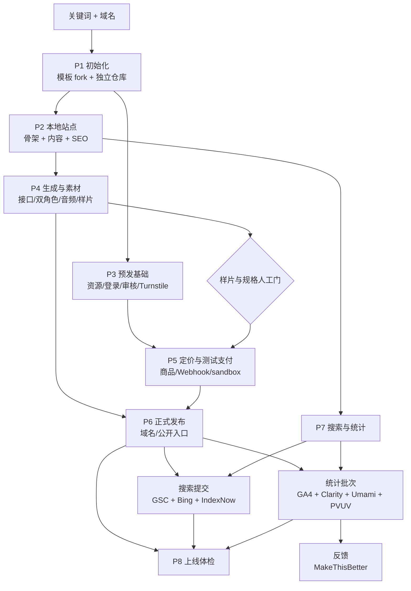

# 建站工作包与全景图

工作包是执行单位，不是历史动作编号。合并原则：

- 同一站点或同一环境；
- 交接能写成明确的输入/输出；
- 中间没有必须由人做的业务决定时，连续执行；
- 有人工门时，一次触发可以跑到门前，保存状态，门后再继续；
- 外部提交、真实付款、生产切换和不同支付商各自保留边界，不硬合并。

## 全景图



图中等待“样片”的分支不阻塞 P2 的 SEO、P3 的资源准备或 P7 的代码接入。

## 工作包表

| 工作包 | 动作 | 类型 | 完成/人工门 |
| --- | --- | --- | --- |
| P1 初始化 | A00 模板 fork 最新版 + A01 独立仓库/remote | 顺序合并 | 模板 fork 包含上游最新版；新仓库回读成功 |
| P2 本地站点 | A02 站点骨架 + A18 内容/关键词 + A27 canonical/入口 | 强合并 | 本地检查通过；未发布前不提交搜索 |
| P3 预发基础 | A09 Cloudflare 资源 + A10 Google 登录 + A13 内容审核 + A14 Turnstile | 并行编排 | 一个 provider 登录失败只暂停该分支，其他分支继续 |
| P4 生成与素材 | A03 素材 + A04 视频接口 + A05 配乐/后处理 + A19 双角色；A12/A23 公开素材 | 带人工门 | 技术链路可连续做；样片、脸/声音/口型、品牌图由人验收 |
| P5 定价与测试支付 | A08 套餐和扣分 + Waffo 或 Dodo 测试商品/Webhook + A22 预发闭环 | 价格确定后合并 | 价格是业务决定；测试支付不碰真实资金；两家支付商分开 |
| P6 正式发布 | A24 正式域名/公开入口 + A20 Waffo 审核材料准备 | 只合并准备 | 生产切换、审核提交、真实付款要有明确授权；审核结果另记 |
| P7 搜索提交 | A28 GSC + A29 Bing + A30 IndexNow | 强合并 | 只提交真实有用的公开页面；平台接收不等于收录 |
| P7 统计接入 | A31 GA4 + A32 Clarity + A33 同意/CSP + A35 Umami + A36 PVUV | 强合并，按 provider 分支 | 一次代码接入、一次部署；后台分别回读；机器人访问照实记录 |
| P7 反馈 | A34 MakeThisBetter | 独立工作包 | 独立项目和隐私遮罩；线上反馈送达才算闭环 |
| P8 上线体检 | `launch-audit` | 独立工作包 | 只读检查、待办和上线结论 |
| 工作区清理 | A26 | 独立维护动作 | 只删可重建工件；不影响发布 |

## 明确不合并

1. Waffo 和 Dodo：不同商户凭据、环境、商品和 Webhook。
2. DNS 托管迁移和正式切站：前者可保留旧站，后者改变真实用户流量。
3. 测试支付和真实付款：后者需要单独授权与验收。
4. Waffo 测试店和正式审核：审核有材料、公开站点和冷却期条件。
5. 反馈和统计：都改前端，但目的、数据边界和隐私处理不同。
6. A07/A08：A07 属于代码收尾，A08 的价格决策不能自动越过；价格确定后的同步可以合并。

## 执行规则

每个工作包开始时读取当前状态和实际 Git/远端；结束时写入 `completed`、`waiting` 和 `next`。一个工作包内部出错时，只回滚该包未完成的写入，不重建已经成功的仓库、商品或统计网站。

同一工作包内的 provider 分支可以并行，但状态要分别记录。使用现有状态工具的标签即可：

```bash
node scripts/site-state.mjs update --project example.com --stage P3 --status in_progress \
  --completed "P3:cloudflare=done,P3:moderation=done,P3:turnstile=done" \
  --waiting "P3:google_oauth=waiting_for_human" \
  --next "finish Google OAuth or continue staging checks"
```

不要因为一个分支等待，就把整个工作包标成 blocked。只有没有任何可执行分支时才标 blocked。
